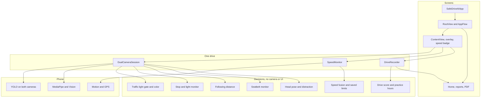

# SafeDriveAI

SafeDriveAI is an intelligent, AI-powered driving coach that helps new and teenage drivers learn safer driving habits. The app monitors driving behaviors, provides visual and audible warnings, and generates a personalized post-drive report analyzing the trip. Once the new driver begins the drive, the front-facing camera constantly checks on the driver, making sure they wear the seatbelt and are focused on the road (distracted driving). At the same time, the app uses the back-facing camera to detect various driving conditions like traffic lights, stop signs, speed limit compliance, and safe following distance. During the drive, if a violation occurs, the app immediately warns the driver with visual and audible signals; it also records the time, location, and a brief video clip of the incident. After each drive, SafeDriveAI creates a personalized post-drive report that summarizes the driver’s performance across categories such as speed, attention, traffic-light compliance, tailgating, stop signs, and their seatbelt usage, rating them all out of 10. It also shows brief video clips surrounding the violations, holding the driver accountable, making them understand and learn from their mistakes, and showing their progress. All the reports are saved locally on the phone and can be reviewed by the driver to evaluate their progress, and each report can be sent via email to instructors and parents. And, in compliance with the NJ DMV’s 50-hour supervised driving requirement, the app also records total driving time.

SafeDriveAI uses GPS location data, the phone’s inbuilt accelerometer, and the OpenStreetMap Overpass API to monitor speed and determine whether the driver is exceeding the road’s speed limit. To identify distracted driving, the app uses iOS’s face tracking system to calculate the yaw, pitch, and roll of the driver’s face. For traffic lights, stop signs, safe following distance, and seatbelt use, it uses two custom-trained YOLO26n (nano) AI models on the front and back cameras. The AI models are run locally on the phone for a streamlined response and quicker feedback. Overall, by combining real-time and hands-free coaching with long-term progress, SafeDriveAI is intended to help new drivers transform ordinary practice drives into opportunities for improvement, and better and safer driving habits.

